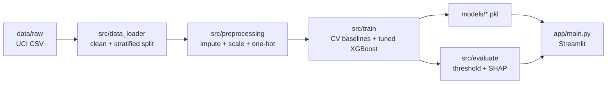
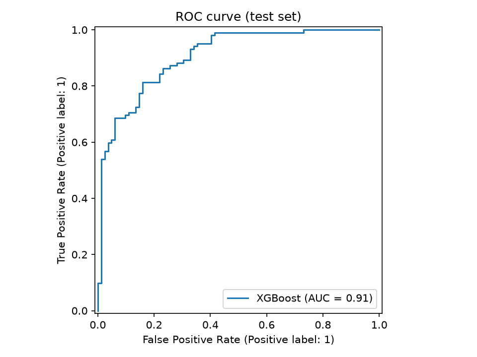
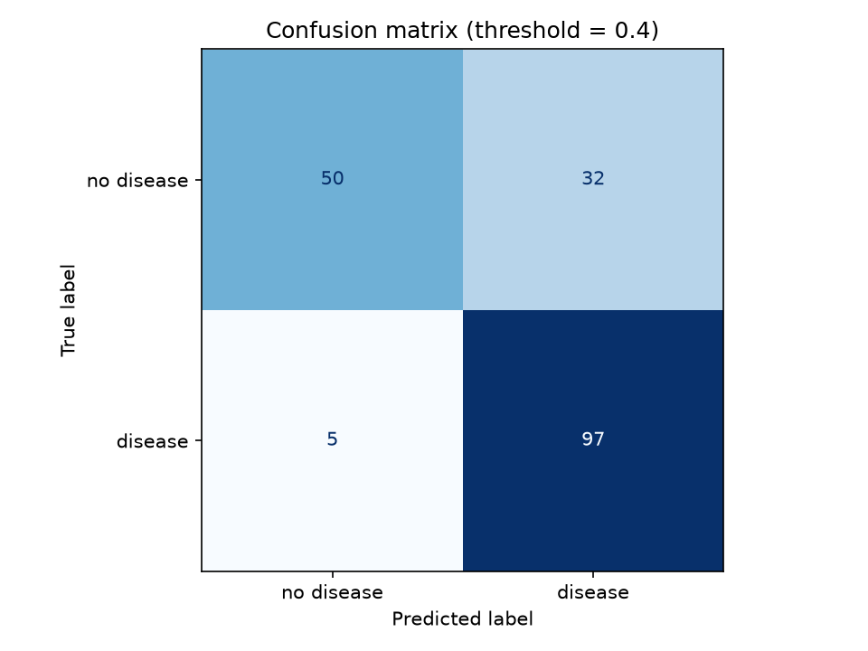
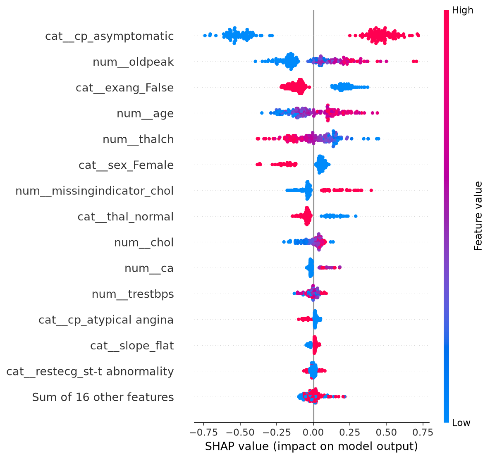

# 🫀 Heart Disease Prediction


An end-to-end, **explainable** clinical-risk pipeline: raw UCI data → cleaning →
preprocessing → tuned XGBoost → SHAP explainability → Streamlit app → Docker.

Ships with the trained model committed, so it runs from a fresh clone with **no
retraining**.



## Results

Disease is the **positive** class. In a screening context a missed case (false
negative) is far costlier than a false alarm, so the model is tuned and
thresholded for **recall**.

| Setting | Recall | Precision | F1 | ROC-AUC | Accuracy |
|---|---|---|---|---|---|
| 5-fold CV, tuned XGBoost (train) | **0.865** | — | 0.826 | 0.854 | — |
| Test set @ 0.5 threshold | 0.873 | 0.795 | 0.832 | 0.907 | 0.804 |
| **Test set @ 0.4 (chosen)** | **0.951** | 0.752 | 0.840 | 0.907 | 0.799 |

Baselines (5-fold CV, train): RandomForest recall 0.847 / AUC 0.871, Logistic
Regression 0.845 / 0.885, XGBoost 0.820 / 0.852 — XGBoost wins after tuning.

| ROC curve | Confusion matrix (t = 0.4) |
|---|---|
|  |  |



## Project structure

```text
├── app/main.py             # Streamlit app (verdict + SHAP waterfall)
├── src/
│   ├── data_loader.py      # load, clean, stratified split
│   ├── preprocessing.py    # single source of truth for the pipeline
│   ├── train.py            # CV baselines + tuned XGBoost (+ MLflow)
│   └── evaluate.py         # test metrics, thresholding, SHAP
├── notebooks/01_eda.ipynb  # exploratory data analysis
├── models/                 # committed: preprocessor.pkl, best_model.pkl, threshold.json
├── data/
│   ├── raw/                # heart_disease_uci.csv (committed)
│   └── processed/          # metrics.json + figures (committed)
├── Dockerfile
└── requirements.txt
```

## Quickstart

```powershell
python -m venv venv
.\venv\Scripts\Activate.ps1          # Windows; use source venv/bin/activate on Unix
pip install -r requirements.txt
streamlit run app/main.py
```

Open http://localhost:8501. Move the sidebar inputs to see the risk verdict and
a per-patient SHAP waterfall explanation.

### Docker

```powershell
docker build -t heart-app .
docker run --rm -p 8501:8501 heart-app
```

### Retrain / regenerate artifacts

```powershell
python src/train.py       # writes models/preprocessor.pkl + models/best_model.pkl
python src/evaluate.py    # writes models/threshold.json + data/processed/*
```

Every split/model/seed uses `random_state=42`. Pinned versions:
`scikit-learn==1.9.1`, `xgboost==3.4.1`, `shap==0.54.1` (see `requirements.txt`).

## Dataset

UCI Heart Disease (Cleveland, Hungary, Switzerland, VA Long Beach; 920 patients).
The multi-class `num` target (0–4) is binarized to `0 = no disease`, `1 = disease`.

- Janosi, A., Steinbrunn, W., Pfisterer, M., Detrano, R. (1988). *Heart Disease*.
  UCI Machine Learning Repository. <https://doi.org/10.24432/C52P4X>
- Kaggle mirror: <https://www.kaggle.com/datasets/redwankarimsony/heart-disease-data>

## ⚠️ Disclaimer

This is an **educational tool — not medical advice**. It was built on a small
historical dataset and must never be used for real clinical decisions.

## License

MIT
